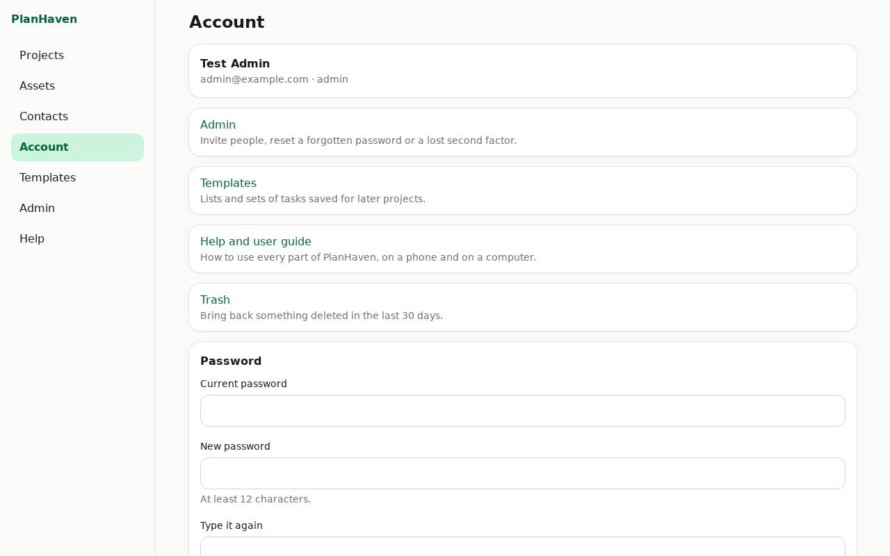

# Your account and security

Open **Account**.

## Passkeys and recovery codes

- **Add a passkey on this device**: sign in with Face ID, Touch ID or a fingerprint here.
- **Remove** a passkey you no longer use.
- **New recovery codes**: makes a fresh set (the old ones stop working). Save them, then tap **I've saved them**.

## Password

**Change password**: enter the **Current password**, then the **New password** twice.

## Signed-in devices

See where you're signed in. **Sign out** one device, or **Sign out all other devices** if a
phone was lost.

## Signed-in apps

The PlanHaven app on your iPhone or iPad, one line per device: its name, when it signed in, and
when and from which address it was last used. **Sign out** ends it straight away; the app asks
you to sign in again.

Signing in from the app:

1. In the app, tap **Sign In**. It opens PlanHaven's own sign-in page.
2. Sign in as usual (password and code, or a passkey), if you aren't already.
3. Check the device name, then tap **Sign in**. You may be asked for your second factor again.
4. You're back in the app, signed in.

The app stays signed in while you use it. It's signed out after 90 days without use (your admin
can change this), and on every device at once when you change your password or use **Sign out
all other devices**.

Some things can only be done here on the web, not in the app: your password, second factors and
passkeys, signed-in devices and apps, AI apps, calendar and sync keys, and share links. The app
says **Do this in PlanHaven on the web.** for those.

## Connected AI apps

AI apps such as Claude that you connected, what each may do, and when it was last used. Change
what an app may do, or **Disconnect** it. See [AI apps](ai-apps.md).

## Experimental features

When an admin has made experimental features available, they're listed here with what they do
and their known risks. Tick one to try it; untick it to stop. Only you are affected, and
anything experimental is marked **Experimental**.

## Signing out

- **On a phone:** **Sign out** is at the bottom of **Account**.
- **On a computer:** **Sign out** is at the bottom of the menu on the left.
